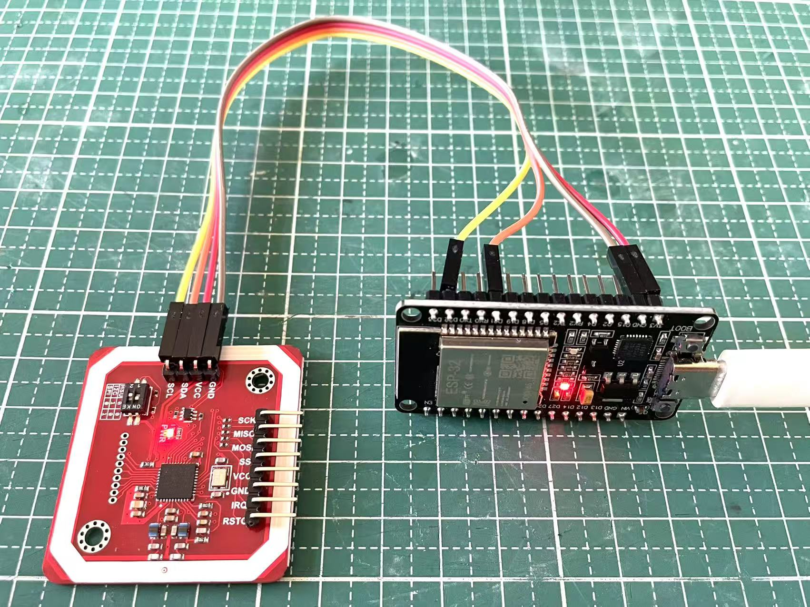
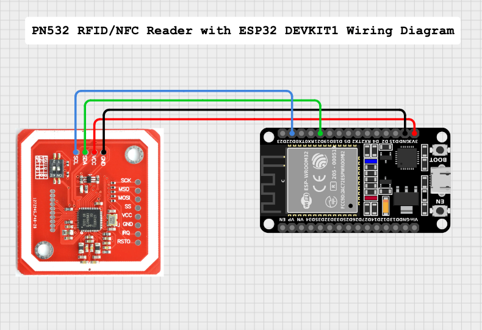

# ESP32 PN532 MIFARE Data Reader

A lightweight ESP32 Arduino project that uses the PN532 module via I2C to detect RFID/NFC cards, authenticate MIFARE Classic sectors, and read sector data (in both Hex and ASCII formats).

<p align="center">
  
  <br>
</p>

---

## ⚡ Features

- **Automatic Chip Detection:** Verifies PN532 connection and prints firmware version on startup.
- **I2C Communication:** Operates at a stable `100 kHz` clock rate.
- **MIFARE Classic Support:** Authenticates block access using default Key A (`0xFF 0xFF 0xFF 0xFF 0xFF 0xFF`).
- **Dual Format Output:** Prints read block data in both **Hexadecimal** and human-readable **ASCII**.

---

## 🛠️ Hardware Requirements

- **Microcontroller:** ESP32 DevKit v1 (or compatible ESP32 board)
- **NFC/RFID Module:** PN532 NFC Module
- **Card Type:** MIFARE Classic 1K / 4K (4-byte UID)
- Jumpers / Wires

---

## 🔌 Wiring Diagram (I2C Mode)

> **Note:** Ensure DIP switches or jumpers on the PN532 board are set to **I2C mode** (usually `I2C`: Channel 1 = LOW, Channel 2 = HIGH, depending on module version).

| PN532 Pin | ESP32 Pin | Description |
| :--- | :--- | :--- |
| **VCC** | `5V` (or `3.3V` depending on module spec) | Power Supply |
| **GND** | `GND` | Ground |
| **SDA** | `GPIO 21` | I2C Data line |
| **SCL** | `GPIO 22` | I2C Clock line |

<p align="center">
  
  <br>
</p>

---

## 📦 Required Libraries

Install the following library via Arduino IDE **Library Manager** (`Ctrl+Shift+I` or `Cmd+Shift+I`):

- **Adafruit PN532** by Adafruit (`Wire.h` is included built-in with Arduino ESP32 core)

---

## 🚀 Quick Start

1. Open `Arduino IDE`.
2. Connect your ESP32 board via USB.
3. Select your ESP32 board under **Tools > Board**.
4. Set Baud Rate in Serial Monitor to `115200`.
5. Upload the sketch.
6. Bring a 4-byte UID MIFARE Classic card near the PN532 antenna.
7. Output
```
=== ESP32 + PN532 MIFARE Data Reader ===
成功偵測到晶片！韌體版本: PN532
初始化完成，請將卡片靠近天線...

-----------------------------------------
>>> 發現卡片！
UID: A1 BB 7E 12 
區塊 4 密碼驗證成功！
錯誤：讀取資料區塊失敗！
-----------------------------------------

-----------------------------------------
>>> 發現卡片！
UID: 9B 0E CE 75 
錯誤：密碼驗證失敗！(可能該區塊已被更改密碼或非標準卡片)
-----------------------------------------
>>> 發現卡片！
UID: 9B 0E CE 75 
區塊 4 密碼驗證成功！
Block 4 資料 (Hex): 00 00 00 00 00 00 00 00 00 00 00 00 00 00 00 00 
Block 4 資料 (ASCII): ................
-----------------------------------------
```

---

## 💻 Code Overview

- **Target Block:** By default, the code authenticates and reads **Block 4** (Sector 1).
  ```cpp
  uint8_t blocknum = 4;
  ```
- **Default Key:** Key A defaults to factory setting:
  ```cpp
  uint8_t keyA[6] = { 0xFF, 0xFF, 0xFF, 0xFF, 0xFF, 0xFF };
  ```

---

## 📊 Sample Output

```text
=== ESP32 + PN532 MIFARE Data Reader ===
成功偵測到晶片！韌體版本: PN532
初始化完成，請將卡片靠近天線...

-----------------------------------------
>>> 發現卡片！
UID: A1 B2 C3 D4 
區塊 4 密碼驗證成功！
Block 4 資料 (Hex): 48 65 6C 6C 6F 20 57 6F 72 6C 64 21 00 00 00 00 
Block 4 資料 (ASCII): Hello World!....
-----------------------------------------
```

---

## 📄 License

This project is open-source and available under the [MIT License](LICENSE).
