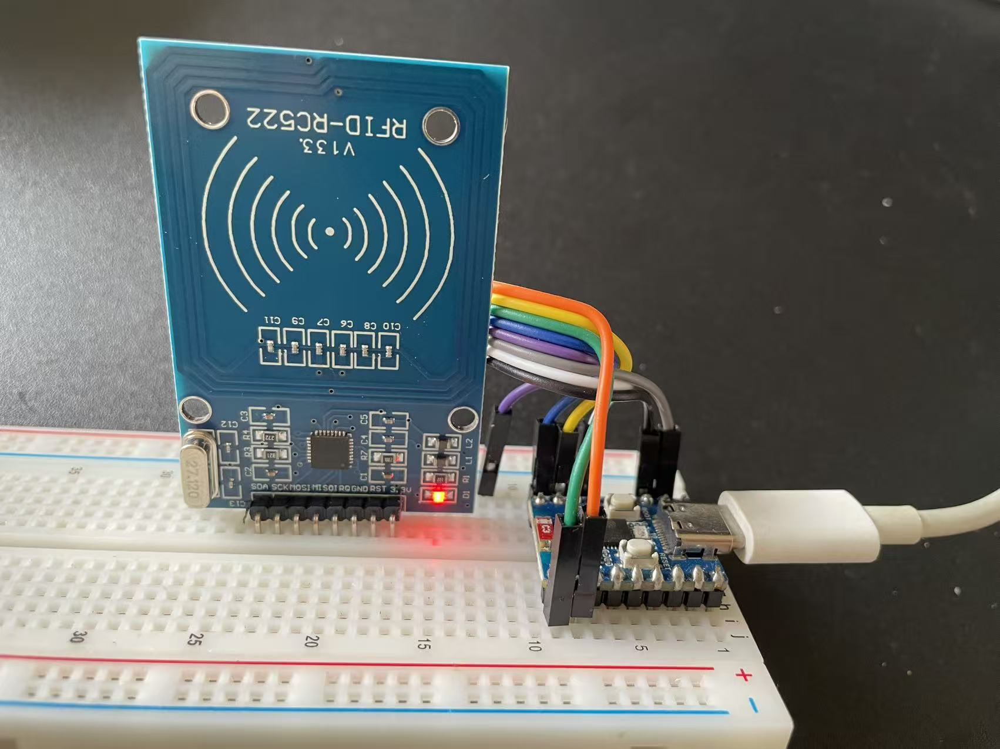
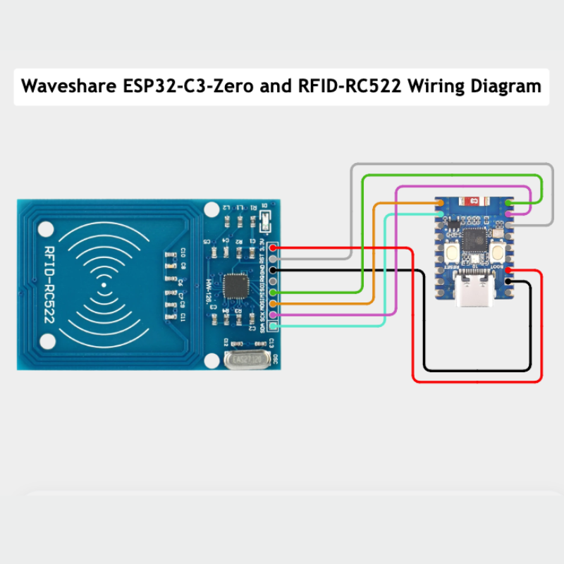

# ESP32-C3-Zero RC522 RFID Read & Write Example

A quick-start Arduino project using an **ESP32-C3-Zero** board and an **MFRC522** module to read from and write data to MIFARE Classic 1K RFID cards/tags.

<p align="center">
  
  <br>
  <em>The assembled prototype with ESP32-S3 and Side-firing cavity speaker.</em>
</p>

---

## ⚡ Features

- **Read Card Data**: Reads card UID and displays Block 4 contents in both ASCII text and HEX format.
- **Write Card Data**: Authenticates with default keys and safely writes 16 bytes of data to Block 4.
- **Custom Hardware SPI Configuration**: Preconfigured specifically for ESP32-C3-Zero pin mapping.

---

## 🛠️ Hardware Requirements

- **Microcontroller**: ESP32-C3-Zero
- **RFID Reader**: MFRC522 SPI Module
- **Tag**: MIFARE Classic 1K Card or Fob

---

## 🔌 Pin Connection Diagram

<p align="center">
  
  <br>
  <em>The assembled prototype with ESP32-S3 and Side-firing cavity speaker.</em>
</p>

| MFRC522 Pin | ESP32-C3-Zero Pin | Function |
| :--- | :--- | :--- |
| **SDA (SS)** | `GPIO 7` | SPI Chip Select |
| **SCK** | `GPIO 4` | SPI Clock |
| **MOSI** | `GPIO 6` | SPI Data Out |
| **MISO** | `GPIO 5` | SPI Data In |
| **RST** | `GPIO 3` | Reset Pin |
| **GND** | `GND` | Ground |
| **3.3V** | `3V3` | Power Supply (3.3V) |

> ⚠️ **Caution**: The MFRC522 operates strictly on **3.3V**. Do NOT connect it to 5V.

---

## 📦 Required Libraries

Install the following library via the **Arduino IDE Library Manager**:

- **`MFRC522`** by *GithubCommunity / miguelbalboa*

---

## 🚀 Quick Start

1. Wire your **ESP32-C3-Zero** and **RC522** according to the pin connections table above.
2. Open the project in Arduino IDE and select your ESP32-C3 board target.
3. Choose the appropriate mode:
   - **Write Data First**: Flash the `write_data.ino` code to write `"Hello RFID 2026!"` into Block 4.
   - **Read Data**: Flash the `read_data.ino` code to read and verify Block 4.
4. Open the **Serial Monitor** at a baud rate of **`115200`**.
5. Bring your RFID card close to the reader.
6. Output
```

========================================
 ESP32-C3-Zero + RC522 卡片讀取測試
========================================
請將寫入過資料的 Mifare 卡片靠近感應區...

[✔] 偵測到卡片 UID:  9B 0E CE 75
[✔] Block 4 資料讀取成功!
    ASCII 字串: ................
    Hex 格式:   00 00 00 00 00 00 00 00 00 00 00 00 00 00 00 00 
----------------------------------------
```

---

## ⚠️ Important Note on Block Addresses

- This example defaults to **Block 4** (Sector 1, Block 0).
- **Do NOT write to Sector Trailer Blocks** (e.g., Block 3, 7, 11, 15...). Writing invalid keys or access bits to trailer blocks can permanently lock your tag.

---

## 📜 License

This project is open-source and available under the [MIT License](LICENSE).
